# State machines

Most of this app is a set of small state machines: a game round is *ready → playing → finishing → done*, a memory-match
turn is *idle → one card up → two cards up*, and so on. Until recently most of them were implicit: a few booleans
(`#paused`, `#finishing`, `#done`) or a string assigned from many places, with the legal moves spread over dozens of
`if (...) return;` guards. That makes it easy to leave a game stuck (see [Findings](#findings)) and hard for a person or an
agent to know what is allowed.

This page lists **every** machine we found, says which are now explicit, and says what to do about the rest.

- **Explicit machines** live in `*.machine.js` files, as data, built with
  [`src/engine/utils/stateMachine.js`](../src/engine/utils/stateMachine.js).
- **The diagrams below are generated from the code** (`npm run machines`) and a unit test fails if they drift, so this page
  cannot go stale.

## Rules

1. **A new screen or rule with more than one phase gets a machine.** If you reach for a second boolean that is only
   meaningful when the first is true, you are writing a state machine.
2. **The table is the source of truth.** A scene or rules class holds a `createMachine(DEFINITION)` and asks it
   `is(...)`, `can(...)` or `hasTag(...)`. It never keeps a parallel flag for the same fact.
3. **Choose the right way to send an event.**
   - `send(event)` returns `false` when the current state does not accept it. Use it for input that may arrive at the
     wrong time (a tap during a lock, a second press of *Next*): the caller ignores it.
   - `must(event)` throws `ILLEGAL_TRANSITION`. Use it for moves the code itself guarantees, so a broken assumption is loud.
   - An event that no state declares always throws (`UNKNOWN_EVENT`): a typo is never mistaken for "ignored".
4. **Ask by tag, not by list of states.** `hasTag('pausable')` keeps working when a state is added; `is('a', 'b', 'c')` does not.
5. **Pause is not a state.** Being paused can happen in any `pausable` state and then changes nothing else, so scenes keep
   one `#paused` boolean *next to* the machine and take the rule "may I pause now?" from the `pausable` tag. (Modelling it
   as a state would double every state.)
6. **Anything that waits (timers, sounds, animations) must say what happens if the tab is hidden or the child leaves.**
   Give that case its own state, as `simon-says/play-flow` does.

## Adding or changing a machine

1. Put the definition in `src/games/<slug>/logic/<name>.machine.js` (or `src/engine/` for engine machines), built with
   `defineMachine`. Use the id `<slug>/<name>`. Export it in `UPPER_CASE`. It is plain data, so `logic/` stays pure.
2. Use it from the scene or class with `createMachine`.
3. Add a block for it to this page in the right section: copy the pair of HTML comments around any existing diagram and put
   the new machine's id in both (they read `machine:<id>:start` and `machine:<id>:end`). Then run:

   ```bash
   npm run machines
   ```

4. Run `npm test`. `tests/engine/machines.test.js` checks that every machine is sound (every state reachable, no dead
   ends that are not marked `final`), that ids follow the convention, and that this page is up to date.

## Explicit machines

### `simon-says/game`: the rules of one game

`src/games/simon-says/logic/simonGame.machine.js`, used by `SimonGame`. `start()` and `addStep()` begin a new sequence from
any phase. `beginInput()` is a no-op unless the sequence was just shown (`send` ignoring the move).

<!-- machine:simon-says/game:start -->
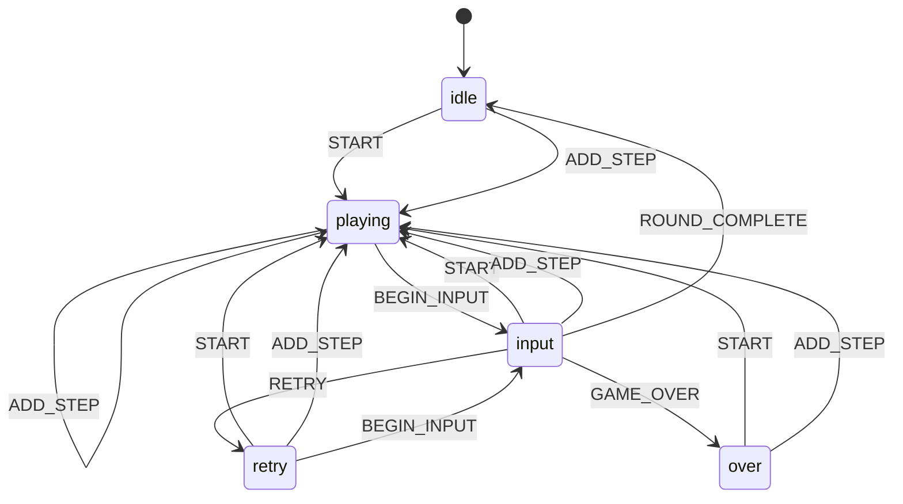
<!-- machine:simon-says/game:end -->

### `simon-says/play-flow`: what the play screen is doing

`src/games/simon-says/logic/playFlow.machine.js`, used by `PlayScene`. Replaces three flags (`#accepting`, `#needsReplay`,
`#leftEarly`) that, between them, could not describe "the tab was hidden during a pause". `suspendedListening` and
`suspendedBetween` are those missing states.

<!-- machine:simon-says/play-flow:start -->
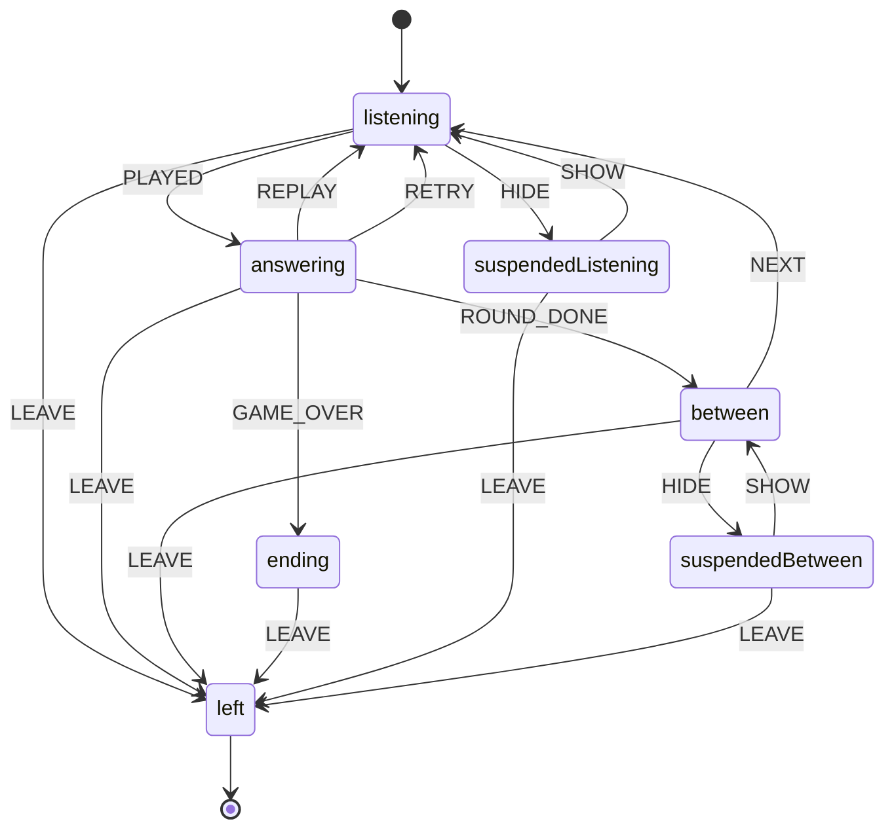
<!-- machine:simon-says/play-flow:end -->

### `hindi-english-match/turn`: one turn of memory match

`src/games/hindi-english-match/logic/matchState.machine.js`, used by `MatchGame`. While `twoUp`, every flip is ignored, which
is what makes rapid tapping during the flip-back harmless.

<!-- machine:hindi-english-match/turn:start -->
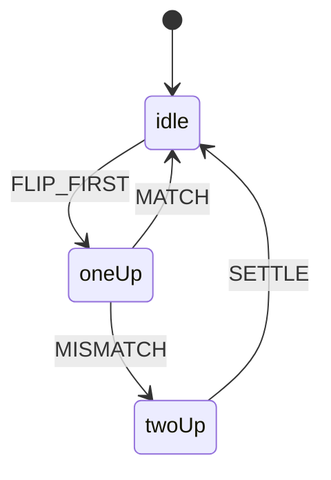
<!-- machine:hindi-english-match/turn:end -->

### `trace-trail/stroke`: one stroke of a letter

`src/games/trace-trail/logic/stroke.machine.js`, used by `StrokeTracker`. Going down at the start while already tracing
begins a fresh attempt, which is why `tracing` has a loop on `START`.

<!-- machine:trace-trail/stroke:start -->
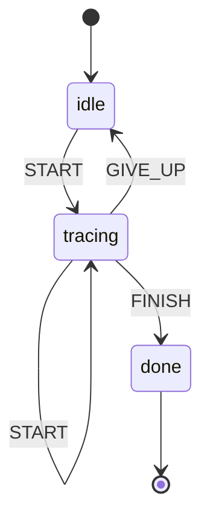
<!-- machine:trace-trail/stroke:end -->

### `trace-trail/glyph-tracer`: the pencil on a whole glyph

`src/games/trace-trail/logic/glyphTracer.machine.js`, used by `GlyphTracer`. Replaces the `#down` flag and the test
`#current >= strokes`. Together with `stroke` (one stroke) and `glyph-flow` (the screen around it) it covers the three
levels of tracing. Which of `STROKE_DONE` and `GLYPH_DONE` happens depends on whether the stroke was the last, which the
glyph knows and the machine does not. `#current` stays a plain index: it says *which* stroke, not *what is allowed*.

<!-- machine:trace-trail/glyph-tracer:start -->
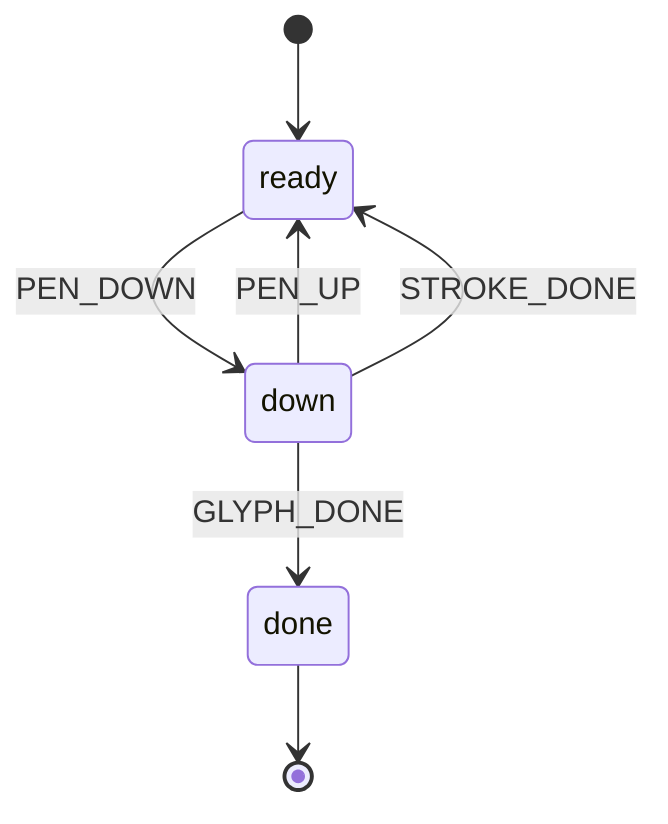
<!-- machine:trace-trail/glyph-tracer:end -->

### `trace-trail/glyph-flow`: one glyph on the tracing screen

`src/games/trace-trail/logic/glyphFlow.machine.js`, used by `TraceScene`. Replaces `#demoing`, `#done` and the test
`!this.#tracer` (which meant "not started yet"). Watch is refused until the tracing rules exist, Skip works at any time
before the glyph is finished, and a second press of the last *Next* is refused instead of asking for the results twice.
(`#off`, "the pencil has strayed", stays a display flag: it changes colours, not what is allowed.)

<!-- machine:trace-trail/glyph-flow:start -->
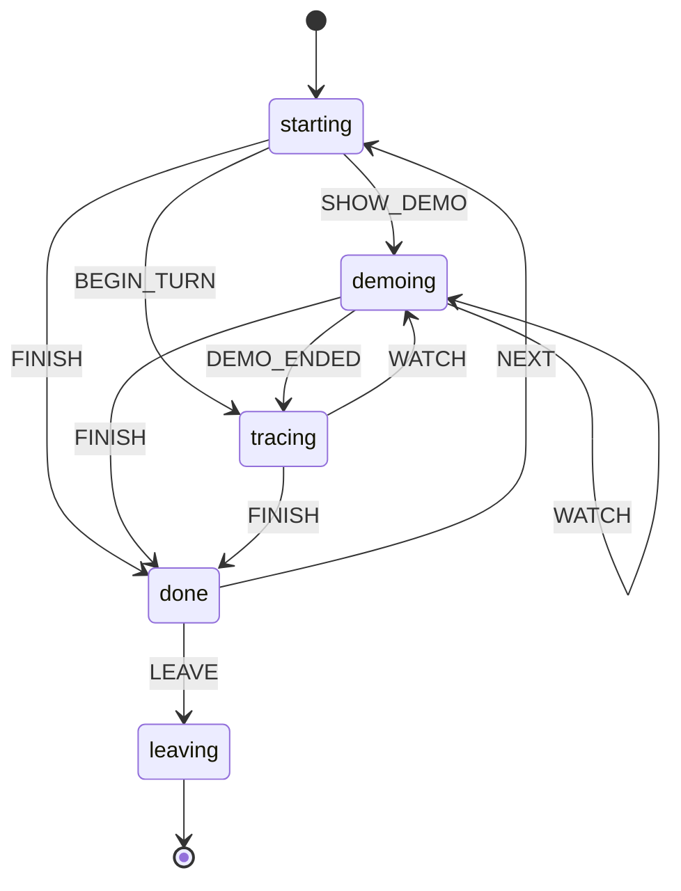
<!-- machine:trace-trail/glyph-flow:end -->

### `number-ninja/play-flow`: the falling-stars screen

`src/games/number-ninja/logic/playFlow.machine.js`, used by `PlayScene`. Replaces `#finishing`, `#done` and the test
`#ready > 0`. Tags: `pausable`, `inputOpen`.

<!-- machine:number-ninja/play-flow:start -->
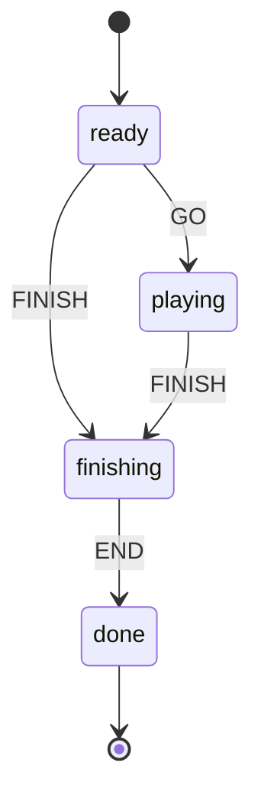
<!-- machine:number-ninja/play-flow:end -->

### `word-builder-bubbles/play-flow`: one word

`src/games/word-builder-bubbles/logic/playFlow.machine.js`, used by `PlayScene`. Replaces `#complete` and `#done`. A second
press of *Next* is now refused by the machine instead of routing twice. Tags: `pausable`, `inputOpen`, `solved`.

<!-- machine:word-builder-bubbles/play-flow:start -->
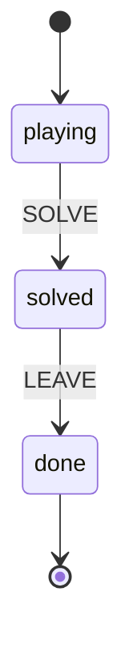
<!-- machine:word-builder-bubbles/play-flow:end -->

### `times-table-racing/race-flow`: one race

`src/games/times-table-racing/logic/raceFlow.machine.js`, used by `RaceScene`. Replaces the string `#phase` (the
"may I pause?" rule is now the `pausable` tag instead of a list of phases).

<!-- machine:times-table-racing/race-flow:start -->
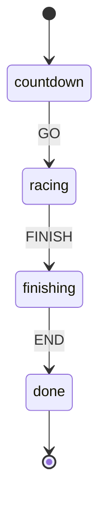
<!-- machine:times-table-racing/race-flow:end -->

### `table-tower/quiz-flow`: the question screen

`src/games/table-tower/logic/quizFlow.machine.js`, used by `QuizScene`. Replaces the string `#phase`. The pause *reasons*
(`hidden`, `settings`) stay a `Set` because several can hold the screen at once.

<!-- machine:table-tower/quiz-flow:start -->
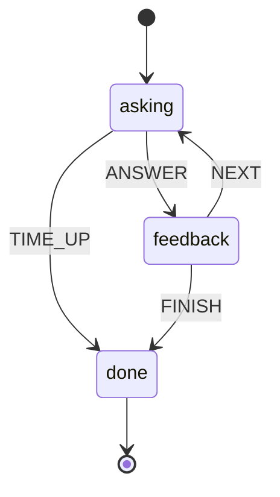
<!-- machine:table-tower/quiz-flow:end -->

### `spot-the-difference/picture-flow`: one picture

`src/games/spot-the-difference/logic/pictureFlow.machine.js`, used by `PlayScene`. Replaces the string `#phase`
(`playing`/`done`). A second press of the last *Next* is refused instead of asking for the results twice. As in
`table-tower/quiz-flow`, the pause *reasons* (`hidden`, `settings`) stay a `Set`, because several can hold the picture at once.

<!-- machine:spot-the-difference/picture-flow:start -->
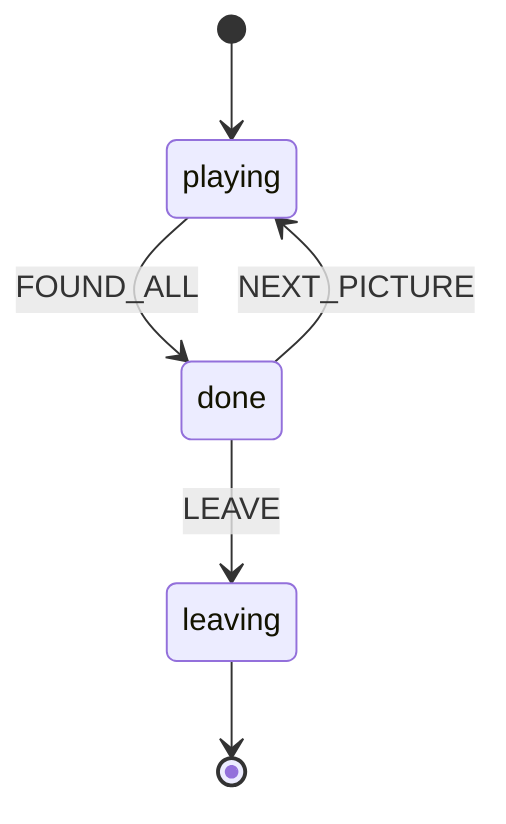
<!-- machine:spot-the-difference/picture-flow:end -->

## Still implicit

Found by searching `src/` for `#phase`, `#status`, `#state` and `#mode` fields and for boolean latches, then reading the
ones that looked like more than a latch. Nothing here is known to be broken; this is the order in which to make them explicit.

### Worth a machine next (several states, or several events that depend on the state)

| Where | What it hides | Suggested states |
| --- | --- | --- |
| `engine/services/InputService` | `#pointer` (`null` / pressed / `dragging`) | `idle → pressed → dragging` |
| `engine/ui/DragDrop`, `food-chain-builder/ui/LinkGesture` | `press` (`null` / pressed / ghost shown) and the `suppressClick` latch | `idle → pressed → dragging → settling` |
| `matra-mixer/logic/session.js` `RoundSession` | `#tries` and `#answered` | `asking → (retry) → revealed → over` |
| `table-tower/logic/session.js` `QuizSession` | `#answeredCurrent` and `#timedOut` | `asking → answered`, `timedOut` |
| `engine/ui/ParentGate` | wrong answer re-asks inside a modal | `asking → (wrong → asking) → passed / cancelled` |
| `hub/HubPage` | `#editing` plus the draft name and avatar | `viewing → editing → saving` |

### Fine as they are (a single one-way or two-way latch)

A latch is a two-state machine. Naming it would add ceremony without removing any risk.

| Where | Flag | Meaning |
| --- | --- | --- |
| `number-ninja/logic/round.js` | `#finished` | round over |
| `sentence-train/scenes/StationScene` | `#finished` | train has left |
| `shop-keeper/scenes/ShopScene` | `#settled` (and `#revealTray`) | sale settled |
| `pizza-fractions/scenes/KitchenScene` | `#settled` | order settled |
| `robot-path/scenes/PuzzleScene` | `#completed` | puzzle solved |
| `pattern-detective/scenes/CaseScene` | `#solved` | case solved |
| `flag-capital-quest/scenes/TripScene` | `#answered` | question answered |
| `food-chain-builder/scenes/WhatIfScene` | `#checked` | answers checked |
| `food-chain-builder/scenes/BuilderScene`, `matra-mixer/scenes/BuildScene` | `#locked` | answer submitted, board locked |
| `simon-says/scenes/MusicScene` | `#playing` | playback in progress |
| `engine/services/AudioService` | `#broken` | Web Audio failed; stay silent (never recovers, on purpose) |
| `engine/ui/Confetti` | `stopped` | animation ended |

If a latch ever grows a third state, or a second flag that only matters when the first is set, promote it to a machine.

### Already explicit (no change needed)

| Where | How |
| --- | --- |
| `engine/SceneManager` | A scene stack with a documented life cycle `enter → (pause ↔ resume)* → exit` |
| `engine/GameLoop` | `running` is the presence of a frame handle; `start()` and `stop()` are idempotent |
| `engine/Game` | `start`, `stop` and `fail`; `fail` is safe to call from anywhere and shows the error screen |
| `engine/services/StorageService` | `isPersistent` and a notice that fires once when saving degrades to memory |
| `engine/ui/Modal` | The native `<dialog>`: open until `close`, and `closed` resolves once |
| `app/registerServiceWorker`, `sw.js` | Registration returns `null` on failure; the worker is inert in `dev` |

### Not machines

`#state` in `lights-out`, `planet-hop`, `plant-grower` and `word-builder-bubbles` holds *data* (a puzzle board, a lineup, a
plant, a spelling record) that is replaced by pure functions. It has no phases, so it is left alone.

## Findings

Making the machines explicit, and testing them in a browser, turned up two real defects.

1. **Fixed: Simon Says could freeze for good.** If the tab was hidden during any pause (the "Get ready…" moment, the pause
   after a won round, the pause before a retry), the pending pause was cancelled but nothing recorded that it had to be
   resumed, so the game never carried on. The old flags could not express that state; `simon-says/play-flow` can.
2. **Fixed: Word Builder Bubbles' screen-reader buttons never popped a bubble.** `physics.step` returns *new* bubble
   objects every frame, but each screen-reader button kept the object it was built with, so `#pop` rejected it
   (`!this.#bubbles.includes(bubble)`). `#pop` now finds the live bubble by `id`. This was unrelated to state machines;
   it turned up while testing them.
